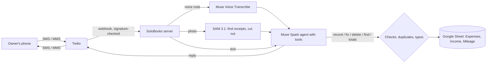

# SoloBooks Agent

[](https://github.com/omerincialan/solo-books-agent/actions/workflows/tests.yml)

**A bookkeeper you text.** Solo tradespeople (tree services, mobile mechanics, coaches) do
their admin from a truck, on a phone, between jobs. Receipts get lost, business miles never get
written down, and the books are a guess until tax time. SoloBooks works entirely over text
messages: send a voice note, a photo of a pile of receipts, or a question, and it keeps the
books in a Google Sheet (expenses, income and business mileage).

Built with **Meta's Muse Spark, SAM 3.1 and Muse Voice Transcribe** (Meta Model API) for the
[Meta Global AI Developer Hackathon](https://cerebralvalley.ai/e/meta-ai-developer-hackathon/details):
Indie track, "Build for Your World".

## What it does

Real replies from the live system (Oct 29, Muse models on the Meta Model API, texting from a phone):

```
Owner:     drove 12 miles to the Henderson job, bought chain oil for 23 bucks, they paid 400 cash
SoloBooks: ✅ Recorded trip 12 mi to Henderson job (T1FA4)
           ✅ Recorded chain oil $23 Equipment & parts (E63ED)
           ✅ Recorded income $400 cash from Henderson (I1409)

Owner:     🎙️ [voice note]
SoloBooks: 🎙️ Heard: "Both gas Chevron for fifty eight dollars and drove twenty miles to the Lee job."
           ✅ Recorded fuel $58 at Chevron (EA2C8)
           ✅ Recorded trip 20 mi to Lee job (T1A38)

Owner:     📸 [one photo of three receipts]
SoloBooks: 🖼️ [the photo back, each receipt outlined and numbered]
           ✅ Recorded receipt 1 GAP $65.81 on Oct 16 (EAF33)
           ✅ Recorded receipt 2 Ross $68.35 on Oct 6 (E1BC4)
           ✅ Recorded receipt 3 Ross $90.02 on Oct 13 (EF444)

Owner:     how much profit this month?
SoloBooks: Oct 1-28: Income $400.00, expenses $305.18, profit $94.82
           32.0 mi, deduction $22.40, profit after mileage $72.42
```

(The voice note said "bought gas"; the transcript shows "Both gas" and Muse Spark still got it
right. Showing what was heard lets the owner catch mistakes.)

- **Voice notes:** one spoken sentence can become several entries.
- **Shoebox mode:** one photo of many receipts becomes one expense per receipt, each linked to
  its own cut-out image, and the photo comes back with every receipt outlined and numbered.
- **Ask your books:** exact income, expenses, profit, miles and mileage deduction for any period.
- **Checks before recording:** likely duplicates and typo-looking numbers are confirmed with the
  owner instead of being recorded silently; totals point out entries recorded twice.
- **Fix by text:** "that was 64.10", "delete the chain oil". Every entry has an ID (`E…`, `I…`, `T…`).

## How Meta's models are used

| Model | Role in SoloBooks |
|---|---|
| **Muse Spark** (`muse-spark-1.3`) | The agent. Tool calling decides what to record, fix, delete or look up; it reads receipt images and splits one message into several entries. |
| **SAM 3.1** (`sam-3.1`) | Finds every "receipt" in a photo. Its boxes are used to cut out one image per receipt; its masks draw the traced outline sent back to the owner. |
| **Muse Voice Transcribe** (`muse-voice-transcribe-1.0`) | Turns phone voice notes into text, with the trade's vocabulary as keywords. |

## How it works



### Design decisions

- **The model decides, the code does the math.** Muse Spark chooses which tools to call, but
  totals, profit and mileage deductions are computed in code (`get_totals`), so every number it
  texts back comes from a tool result and can be checked against the sheet.
- **Nothing doubtful is recorded silently.** Record tools run checks first (`solobooks/checks.py`)
  and return `needs_confirmation` instead of saving; the agent asks the owner and only records with
  `confirm=true`. Mistakes are caught while the owner still remembers the purchase.
- **IDs on every entry** make fixes exact ("delete E63ED") and replies verifiable.
- **Text messages, not an app.** No install, no login, no forms; it works on any phone. Replies
  are sent in the background, so slow steps (six receipts, a long voice note) never hit Twilio's
  webhook timeout.
- **Safe by default:** only the owner's number is served; every request must carry a valid
  Twilio signature; values are written to the sheet as plain text (never formulas); receipt
  photos live behind unguessable links.

| File | What it does |
|---|---|
| `solobooks/agent.py` | Muse Spark tool-calling loop, tools and system prompt |
| `solobooks/books.py` | The Google Sheet ledger (add / update / delete / list, with IDs) |
| `solobooks/checks.py` | Duplicate and sanity checks run before anything is recorded |
| `solobooks/shoebox.py` | SAM 3.1: finds receipts, cuts them out, draws the traced outlines |
| `solobooks/voice.py` | Converts voice notes to WAV and transcribes them with Muse Voice Transcribe |
| `solobooks/server.py` | Twilio webhook, background processing, replies by SMS/MMS, photo links |
| `solobooks/trades.py` | Expense categories per trade (tree service, mechanic, tennis coach) |
| `solobooks/memory.py` | Last few turns of the conversation (SQLite) |
| `solobooks/photos.py` | Stores receipt photos behind unguessable links |
| `scripts/smoke_test.py` | Checks your Meta Model API key, tool calling and vision with real calls |
| `tests/` | Tests with a scripted Muse Spark and an in-memory sheet (run on every push) |

## Setup

1. `sudo apt install ffmpeg`, then `python3 -m venv venv && venv/bin/pip install -r requirements.txt`
2. `cp .env.example .env` and fill it in (Meta Model API key, Twilio, owner's number, sheet ID, trade).
3. Google Sheet: create a service account with the Sheets API enabled, save its key as
   `google_service_account.json`, and share the sheet with it as **Editor**.
4. Check the Meta Model API: `venv/bin/python -m scripts.smoke_test`
5. Run: `venv/bin/gunicorn -w 2 solobooks.server:app`, and point the Twilio number's
   **Messaging** webhook to `PUBLIC_URL` (e.g. `http://YOUR-SERVER/sms`, HTTP POST).

Tests: `venv/bin/pip install pytest && venv/bin/python -m pytest`

## Built during the hackathon (Oct 27 – Nov 4, 2026)

Everything in this repository was written during the hackathon; the git history starts on
Oct 27. Progress log:

- **Oct 27** – Agent core: Muse Spark tool-calling agent over a Google Sheet ledger with
  entry IDs; one message can record several entries; exact totals computed in code;
  Twilio webhook with signature check, background replies and conversation memory.
- **Oct 28** – Voice notes: a voice message (AMR, M4A, MP3, OGG… converted with ffmpeg) is
  transcribed by **Muse Voice Transcribe** and handled like a text, so one spoken note can
  create several entries. The reply starts with what was heard, so the owner can check it.
- **Oct 28** – Shoebox mode: one photo of a pile of receipts. **SAM 3.1** finds each receipt
  ("receipt" concept), the photo is cut into one image per receipt, and Muse Spark records
  each as its own expense linked to its own cut-out. The owner gets the photo back with every
  receipt numbered. Falls back to the whole photo if SAM finds fewer than two.
- **Oct 28** – Checks before recording: likely duplicates (same total and date, or same vendor
  and amount within 3 days) and implausible values (amount far above normal, tax ≥ total or
  over 20%, dates in the future or over a year old, 400+ mile trips) are not recorded; the
  agent asks the owner and records only once they confirm. `get_totals` also lists entries
  already recorded twice.
- **Oct 29** – Deployed and tested end to end on the live Meta Model API from a real phone
  (replies above). Expenses without a store are recorded without a vendor and the agent asks
  where it was bought. The returned photo now traces each receipt's outline from SAM's masks.
  Tests run on GitHub Actions on every push.
